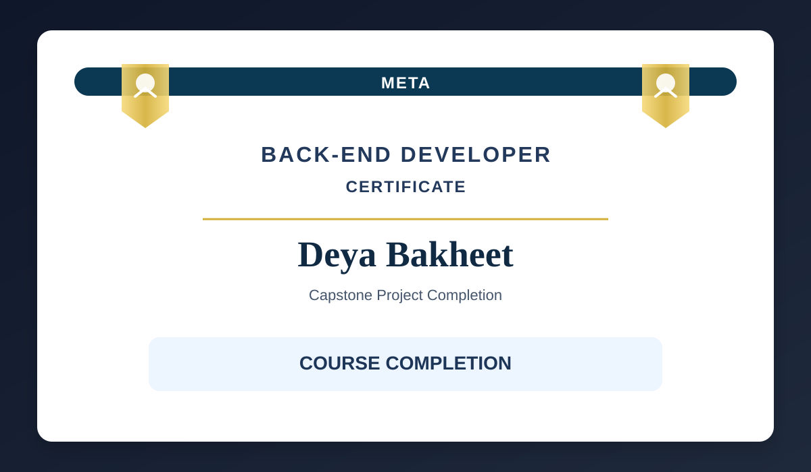

<p align="center">
  
</p>

# Little Lemon Restaurant Capstone

A Django-based restaurant booking and menu management application developed as the capstone project for the Meta Back-End Developer Certificate on Coursera.

This project demonstrates full-stack backend development capabilities using Python, Django, and the Django REST Framework. It includes customer-facing restaurant pages, menu management, booking records, and authenticated API access.

## Certificate

This capstone project was completed as part of the Meta Back-End Developer Certificate program.

<p align="center">
  
</p>

## Project Overview

Little Lemon is a restaurant management application designed to support:

- Menu item management
- Reservation and booking records
- Customer-facing pages for restaurant services
- REST API endpoints for menu and table booking data
- Protected access using authentication
- Database-backed application logic with MySQL

## Tech Stack

- Python
- Django
- Django REST Framework
- MySQL
- HTML, CSS, JavaScript
- Djoser

## Features

- Manage restaurant menu items through API endpoints
- Create and retrieve booking records
- Secure protected API access with authentication
- Render menu and reservation web pages with Django templates
- Store structured data using relational models
- Demonstrate backend engineering practices in a real-world project

## Project Structure

```text
DeyaBakheetCapstone/
├── config/
│   ├── __init__.py
│   ├── asgi.py
│   ├── settings.py
│   ├── urls.py
│   └── wsgi.py
├── littleLemon/
│   ├── migrations/
│   ├── templates/
│   ├── __init__.py
│   ├── admin.py
│   ├── apps.py
│   ├── models.py
│   ├── serializers.py
│   ├── tests.py
│   ├── urls.py
│   └── views.py
├── assets/
│   └── meta-certificate.svg
├── manage.py
├── README.md
├── requirements.txt
├── .gitignore
└── db.sqlite3
```

## Key Models

- `Menu`
  - `title`
  - `price`
  - `inventory`

- `Booking`
  - `name`
  - `number_of_guests`
  - `booking_date`

## Main Routes

- `/` — Home page
- `/about/` — About page
- `/menu/` — Menu items and menu API
- `/reservations/` — Reservation page
- `/booking/` — Booking API endpoints
- `/menu/<int:pk>` — Single menu item endpoint

## Setup Instructions

1. Clone the repository

```bash
git clone https://github.com/diaabashtawi/DeyaBakheetCapstone.git
cd DeyaBakheetCapstone
```

2. Create a virtual environment

```bash
python -m venv venv
source venv/bin/activate     # macOS/Linux
venv\Scripts\activate        # Windows
```

3. Install dependencies

```bash
pip install django djangorestframework mysqlclient djoser
```

4. Configure the database in `config/settings.py`

Update the MySQL connection parameters to match your local environment.

5. Apply migrations

```bash
python manage.py makemigrations
python manage.py migrate
```

6. Run the development server

```bash
python manage.py runserver
```

7. Open the app in your browser

```text
http://127.0.0.1:8000/
```

## Testing

Run the test suite with:

```bash
python manage.py test
```

## Author

Deya Bakheet

## Repository

https://github.com/diaabashtawi/DeyaBakheetCapstone

## Note

This project was created as part of the Meta Back-End Developer Certificate and reflects practical backend development skills in a real-world restaurant application context.
